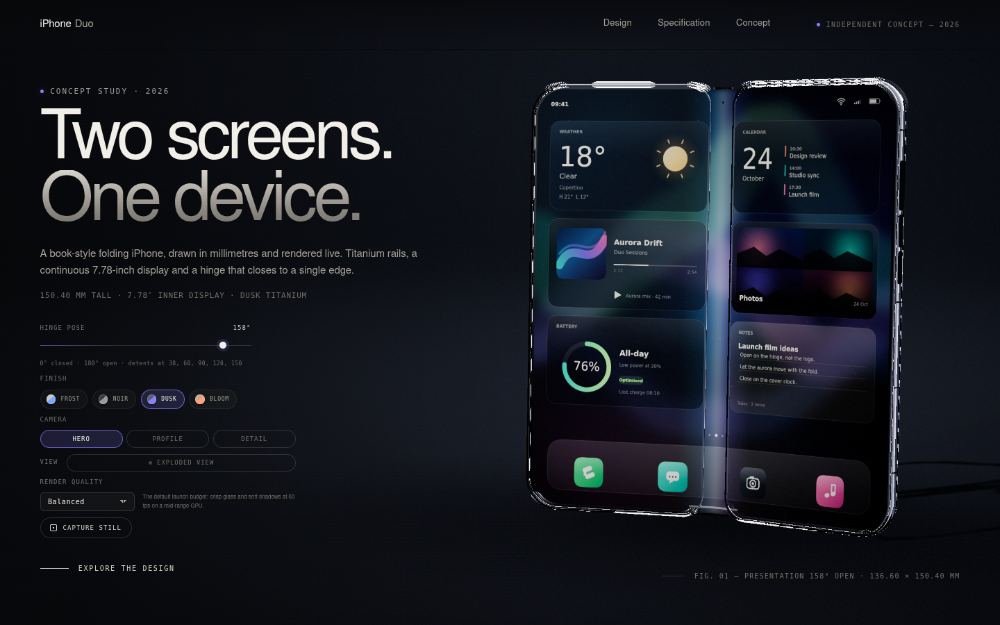

# iPhone Duo

**Two screens. One device.** A browser-based, photorealistic product launch page
for iPhone Duo, an independent concept study of a book-style folding iPhone.
Everything is rendered live in Three.js at real-world scale: no downloaded
models, no HDRIs, no screen bitmaps.

[**Open the live experience →**](https://gerrcass.github.io/webgl-duo/)



## The concept

The Duo closes like a book and opens into a single 7.78-inch canvas. Two rigid
halves share one vertical hinge axis; a 10 mm flexible bridge carries the inner
display across the fold, so the device reads as one object rather than two
panels bolted together. The page pairs a live studio with the design story: the
hinge, the display bridge, the titanium and glass finishes, and a measured
specification sheet.

This is fiction, presented honestly. iPhone Duo is **not** an Apple product and
is not affiliated with, endorsed by, or sponsored by Apple Inc. All screen
artwork is original **Duo OS** artwork; no Apple assets, prices or purchase links
are used.

## Controls

The studio console sits under the hero copy:

- **Hinge pose** — the fold slider sweeps the rig from **0° (closed)** to
  **180° (open)**, with detents at 30, 60, 90, 120 and 150. The hero opens at the
  158° presentation angle.
- **Finish** — four colourways (Dusk, Frost, Bloom, Noir) shift the rails, rear
  glass, camera plateau and interface accent together.
- **Camera** — Hero, Profile and Detail presets reframe the same physical scene;
  the camera moves, the device never rescales.
- **Orbit and zoom** — drag the stage to orbit, scroll or pinch to zoom, use the
  arrow and +/- keys when the stage is focused, and press 0 to reset.
- **Exploded view** — separates the assembly into labelled layers while keeping
  the hinge relationship readable.
- **Render quality** — Cinematic, Balanced and Efficient tiers trade pixel ratio
  and post-processing for frame rate.
- **Capture still** — downloads the current canvas as a PNG.

URL flags for reproducible inspection: `?test=1` disables intro motion, starts in a fixed
fold angle and colourway, and fixes the camera for deterministic evidence;
`?fallback=1` shows the designed poster used when WebGL2 is unavailable.

## Architecture

The app is a vanilla TypeScript + Three.js bundle behind a small facade:

```
src/domain/     reference.ts (the dimensional sheet), kinematics.ts (fold rig),
                store.ts (state + reducer), quality.ts (render tiers), duo-os.ts
src/scene/      studio.ts, environment.ts, renderer.ts, framing.ts, materials.ts,
                device/ (shell, hardware, hinge), display/ (Duo OS canvas artwork)
src/app/        duo-app.ts (DuoApp facade), boot.ts (DOM binding), content.ts
```

`DuoApp` is the only seam tests and the DOM share: `mount`, `dispose`,
`setColourway`, `setFoldAngle`, `setPreset`, `setExploded`, `setQuality`,
`orbitBy`, `zoomBy`, `resetOrbit`, `getOrbit`, `captureScreenshot`, `getState`.
The DOM never reaches into scene objects, and the scene never reads the DOM.

The studio is procedural too: a dark cyclorama, softbox reflections built from
emissive geometry, and a contact shadow. The displays are drawn into canvases at
device resolution — a home screen, lock screen and app artwork in the invented
Duo OS visual language — then mapped through the hinge rig so the bridge bends
with the panel.

## Accuracy strategy

- **One reference sheet.** `docs/design/reference-design.md` is the dimensional
  source of truth; `src/domain/reference.ts` encodes it once. Geometry code reads
  named constants, never magic numbers.
- **Metres, 1:1.** A 150.40 mm device is 0.1504 scene units. The model is never
  scaled to fit a viewport; framing moves the camera instead.
- **The fold is a rig.** Both halves parent to the hinge, and the display bridge
  follows a constant-length arc. Unit tests assert clearance at 0°, 90°, 158° and
  180°.
- **Procedural only.** Geometry, materials, lighting and screen artwork are
  generated in code. A new binary asset would need an ADR.
- **Pixels are tested.** Playwright probes sampled canvas regions for contrast
  and colour variety, so a flat or blank screen fails the suite; it also asserts
  ready state, fold, colourway, preset and exploded changes, and the fallback.

## Evidence

`npm run test:e2e` writes the deterministic shots under `docs/evidence/` (and CI
uploads them as artifacts):

| File | What it shows |
| --- | --- |
| `hero-desktop.png` | The default hero at 1440 × 900 |
| `hero-mobile.png` | The mobile hero at 390 × 844 |
| `folded.png` | The rig at 90° |
| `exploded.png` | Labelled exploded assembly |
| `detail.png` | Detail macro on the camera plateau and rail |
| `colourways.png` | Four-finish comparison |

Every shot comes from `?test=1`, so it is motion-free; the evidence suite drives explicit deterministic states and waits for a settled frame rather than a wall-clock delay.

## Run it locally

```sh
npm ci
npm run dev          # Vite dev server at http://127.0.0.1:5173
npm run typecheck    # tsc --noEmit
npm run test         # Vitest unit tests
npx playwright install --with-deps chromium   # once, before browser tests
npm run test:e2e     # Playwright smoke + evidence shots (rebuilds via webServer)
npm run build        # static production build in dist/
npm run preview      # preview the production build
```

CI runs typecheck, unit tests, build and Playwright on every push and pull
request (`.github/workflows/ci.yml`). Pushes to `main` build `dist/` and deploy it
with the official GitHub Pages actions (`.github/workflows/pages.yml`), so the
live URL always matches the current build. The build uses relative asset paths
(`base: './'`) and needs no server or secrets.

## Known follow-ups

- Under SwiftShader, a dashed specular seam remains at the rail/glass silhouette
  at grazing angles. Materials, tessellation, softbox intensity and glass recess
  have been adjusted; this is the main outstanding visual defect.
- The 390 × 844 mobile hero now fills more of the stage but still overlaps the
  headline; it needs another portrait framing pass.
- The 10 mm bridge preserves developed length exactly, but the nominal 1.8 mm
  bend radius is only met around 123° open; full closure is a constant-length
  hairpin (reference sheet §11.3).
- The Apple mark is on the left half's exposed rear glass because the right half's
  rear face carries the cover display and plateau (reference sheet §11.6).

---

iPhone Duo is an independent concept study. It is not an Apple product and is
not affiliated with, endorsed by, or sponsored by Apple Inc. All screen artwork
is original Duo OS artwork; no Apple assets are used.
